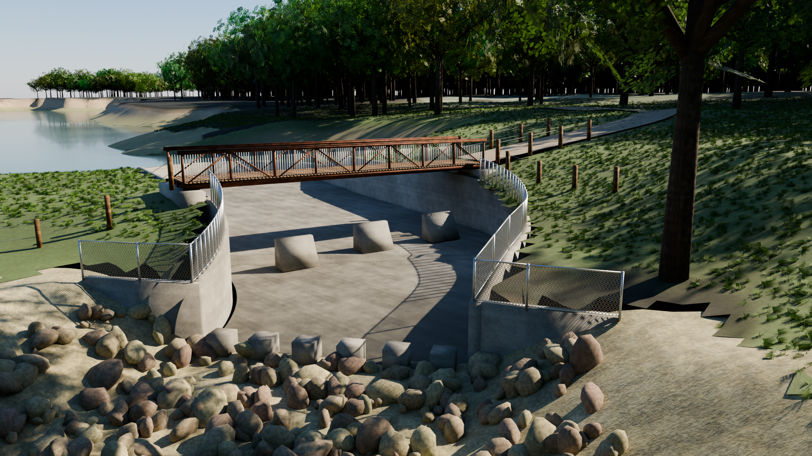
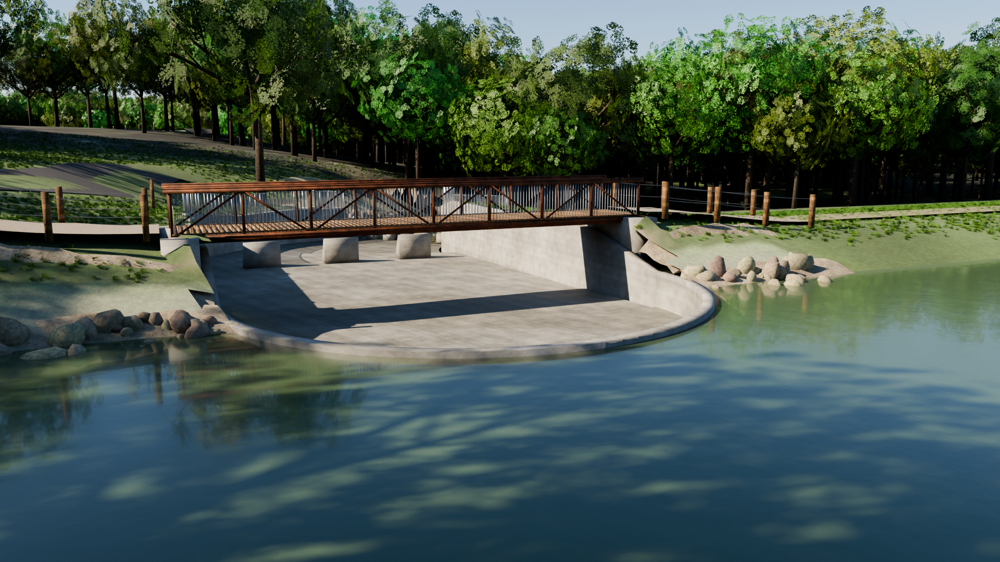
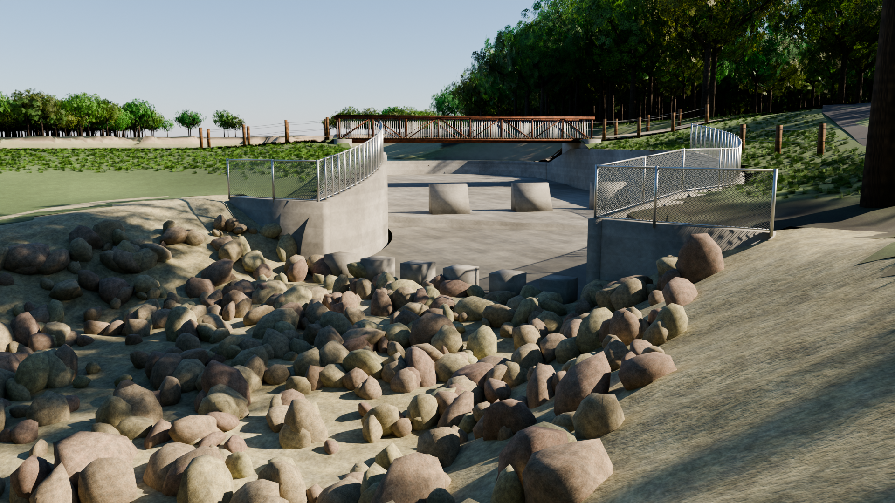
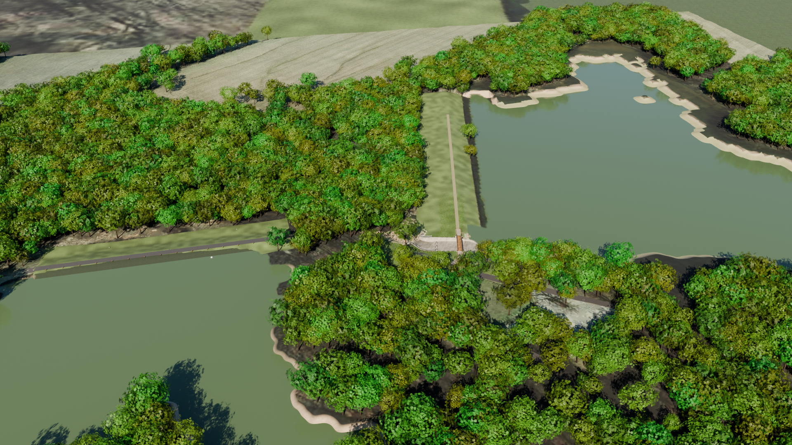

# White Oak Lake Dams – 3D Reconstruction

A photoreal-leaning 3D reconstruction of the **White Oak Lake Dams Rehabilitation of Dam 1 and 2 / Dam Upgrade Project**
(Indiana Department of Natural Resources, Project No. E015001L, White Oak State Fishing Area, Knox County, Indiana),
built from the September 2013 bid-set drawings (30 sheets, Commonwealth Engineers / KIVA Structural Engineers).

Version 2 rebuilds the whole scene in **Blender 5.2** and renders it with **Cycles**; the web viewer now loads the Blender scene
exported to glTF. The original procedural Three.js build is kept as `viewer-legacy/`.

**Live:** https://youngbrain85.github.io/white-oak-lake-dams-3d/ (render gallery) ·
https://youngbrain85.github.io/white-oak-lake-dams-3d/pano/ (360° Cycles panorama tour) ·
https://youngbrain85.github.io/white-oak-lake-dams-3d/viewer/ (interactive viewer)



| Semicircular weir | Riprap outlet channel | Aerial |
|---|---|---|
|  |  |  |

## Repository layout

| Path | Contents |
|---|---|
| `blender/build_scene.py` | Builds the complete scene with the `bpy` module (terrain, lakes, spillway, bridge, rocks, trees, grass, sky, cameras), renders the preset views and exports the GLB. |
| `blender/gen_blender_textures.py` | Procedural, tileable PBR textures and the leaf / grass alpha cards used by the Blender materials (`blender/tex/`). |
| `model/white_oak_lake_dams.blend` | The saved Blender scene (open in Blender 4.2+ / 5.x). |
| `model/white_oak_lake_dams_blender.glb` | Full scene exported from Blender (33 MB). `*.pack.glb` is the meshopt-compressed copy the viewer loads (16 MB); `*_lite*` has decimated terrain for the claude.ai artifact. |
| `model/white_oak_lake_dams.glb` | Version 1 export from the procedural Three.js scene. |
| `viewer/` | Three.js viewer for the Blender GLB (meshopt decoding, GPU instancing of the 7,936 trees and 1,750 rocks, AgX tone mapping, Sky). Has an optional **path-tracing mode** (three-gpu-pathtracer) that renders the same scene with physically based path tracing on the viewer's GPU: sun + sky importance sampling, 4 bounces, progressive convergence. |
| `model/trees_lite.glb` | Low-poly tree variants used for the far field in path-tracing mode. |
| `model/white_oak_lake_dams_blender_baked.glb`, `model/lightmaps/` | Baked variant: the static structures joined into `StructuresBaked` / `SurfacesBaked` with a second UV set, plus four 2048² lightmaps (sRGB-encoded irradiance, `scale` in `lightmaps.json`). Built by `blender/bake_lightmaps.py` (prepare → bake per group → finish). The unbaked GLB is kept for the fallback. |
| `viewer-legacy/` | Version 1 procedural viewer. |
| `renders/cycles/` | Cycles renders of the ten camera presets, 1920×1080, 96 samples + OpenImageDenoise. |
| `pano/` | 360° tour: six equirectangular Cycles panoramas (3072×1536, 64 samples) with a small Three.js viewer and hotspot links between viewpoints (`blender/make_pano_tour.py` builds it from `blender/out/panos/`). |
| `renders/*.png` | Version 1 real-time renders. |
| `tools/` | Version 1 generators: heightmap / albedo / vegetation placement from the aerial (`gen_terrain.py`), textures, headless renderer. |
| `ref/` | Existing-condition photos and the 2005 aerial crop extracted from the PDF. |
| `index.html` | GitHub Pages landing page with the render gallery. |

## Rebuilding

```bat
pip install bpy==5.2.3 numpy pillow scipy
python blender\gen_blender_textures.py
python blender\build_scene.py --build
python blender\build_scene.py --render preview        :: 960x540 quick check of every preset
python blender\build_scene.py --render final bridge   :: 1920x1080, 96 samples
python blender\build_scene.py --export                :: model\white_oak_lake_dams_blender.glb
python blender\bake_lightmaps.py --prepare           :: join static meshes, add lightmap UVs
python blender\bake_lightmaps.py --bake terrain_inner :: (also structures, surfaces, terrain_outer; ~10 min each)
python blender\bake_lightmaps.py --finish            :: model\lightmaps\*.jpg + baked GLBs
python blender\build_scene.py --pano                  :: six 360° panoramas -> blender\out\panos
python blender\make_pano_tour.py                      :: pano\*.jpg + pano\tour.json
npx gltfpack -i model\white_oak_lake_dams_blender.glb -o model\white_oak_lake_dams_blender.pack.glb -cc -kn -km -vp 14 -vt 12 -noq
```

The build takes a few seconds; a final frame takes roughly ten minutes on four CPU cores. The scene needs the version 1 assets in
`viewer/assets/` (heightmap, aerial albedo, water and cut masks, tree positions), which `tools/gen_terrain.py` produces from the aerial on sheet 3.

Serve `viewer/` over HTTP (`python -m http.server 8000` in the repository root, then open `/viewer/`); the model is fetched from `../model/`.

## Seeing the Blender scene on the web

Blender itself does not run in a browser, so the scene reaches the web three ways, in increasing fidelity and cost:

| Mode | Where | What you get |
|---|---|---|
| Real-time, baked | `viewer/` (default) | glTF of the Blender scene with **Cycles lighting baked into lightmaps** for the terrain, concrete and paths (sun, sky, bounce light and tree shadows at 2 px/ft), so the ground and structures look like the Cycles renders while trees, rocks and water stay dynamic. Switch *Baked Cycles lighting* off in the menu to fall back to dynamic shadow-mapped lighting. |
| Path traced | `viewer/` → "Path tracing on your GPU" | The same glTF rendered by [three-gpu-pathtracer](https://github.com/gkjohnson/three-gpu-pathtracer): true global illumination, soft shadows, glossy water, same sun/sky as Cycles. Converges in a few seconds on a desktop GPU; needs WebGL2 with float textures and about 1 GB of GPU memory for the *full* setting (1.4 M triangles). |
| Pre-rendered | `pano/` and `renders/cycles/` | Cycles output: 360° panoramas from six viewpoints and ten fixed views. Highest quality, fixed viewpoints. |

## What the Blender scene contains

* **Terrain** – 2 ft grid within 500 ft of the spillway, 6 ft beyond, from the 16-bit heightmap; aerial albedo overlaid with tiled grass detail, slope-dependent exposed soil, normal map.
* **Lakes** – masked water planes at EL 476.6 and 490.4 with a glossy, slightly murky shader and procedural ripples.
* **Dam No. 1 spillway** – left/right walls and wing walls from the plan polylines (1 ft thick, bottoms at EL 466), 20.5 ft semicircular weir, half-disk + ribbon slab following the longitudinal profile, 3 baffle blocks, 6 end-sill blocks, bridge abutments, 42 in. chain-link on the wall tops, riprap apron and outlet channel with 1,750 individually placed rocks.
* **Bridge** – 46 ft × 8 ft steel truss with chords, posts, diagonals, pickets, handrails, three stringers and 2×6 plank deck.
* **Site** – 8 ft stone walkway from the bridge (on the Dam No. 1 centreline, sta 30+56) round an R = 40 ft bend to the existing asphalt access drive, the mown track along the regraded dam crest on the far side, both asphalt drives traced from the 2005 aerial, post-and-cable fences, Dam No. 2 crest road, posts, 48 in. CMP riser with grate, toe-drain outlets.
* **Vegetation** – three procedural broadleaf tree variants (trunk, two branch levels, 340 leaf cards each) instanced at the 7,936 positions classified from the aerial, with per-instance hue variation; 42,000 grass clumps scattered near the spillway with a density vertex group.
* **Lighting** – Nishita (multiple-scattering) sky, sun elevation 34°, AgX view transform.

## Design data reflected in the model

| Element | Value | Sheets |
|---|---|---|
| Overflow weir | Semicircular, 20.5 ft inside radius, crest EL 477.0 (normal pool), 1 ft thick | 7, 27, 29 |
| Spillway walls | 1 ft thick, top EL 480 → 477 → 476, bottom EL 466–467 | 27, 28, 29 |
| Floor slab | 24 / 18 / 12 in., EL 473.46 → 472.0 → 470.0, curved section R = 35.5 ft (left) / 31.5 ft (right) | 27, 28 |
| Baffle blocks | 3, 3 ft 9 in. high, upstream face 60 ft from the weir center | 27, 30 |
| End-sill blocks | 6, 2 × 2 ft × 1 ft 9 in. | 29 |
| Pedestrian bridge | 46 ft clear span, 8 ft wide, pre-engineered steel truss, deck EL 482.0 (bottom of steel ≥ 481.75) | 30 |
| Fencing | 42 in. chain-link on wall tops; 6×6 post-and-cable fence at the approaches | 15 |
| Outlet channel | 24 in. Class I riprap, invert EL 470 → 466, 23 ft → 40 ft wide, 2:1 side slopes | 10, 11 |
| Dam No. 1 | Crest EL 480, 10:1 downstream slope, 3:1 upstream, toe drain | 12–14, 16–18 |
| Dam No. 2 | Crest EL 495, 3:1 slopes, paved access drive on crest, 48 in. CMP riser (EL 490.31), toe drain outlets | 19–24 |
| Pool levels | Lake 1 EL 477.0 (lowered from 482.4), Lake 2 EL 490.4 | 7, 19 |

Coordinate frame: Blender X = east, Y = north, Z = elevation (ft, NAVD88); the glTF export is Y-up (X east, Y up, Z south).
The spillway is modelled in a local frame whose origin is the weir center (spillway station 30+45) with +x pointing downstream (WNW).

## Assumptions and limits

* Terrain is an interpolation of the 2005 aerial (1 in. = 200 ft) and the spot elevations / profiles in the drawings. It is not survey data.
* Trees and grass are placed by classifying woodland in the aerial; species, heights and positions are plausible, not surveyed.
* Buried work (cut-off wall, toe drains, waterstops, reinforcing) is not modelled.
* No public photographs of the completed project could be found online; the only references used are the photos and aerial contained in the bid set.

## Rolling back the baked lighting

The state before baking is the branch `prebake` (commit fd64726). To go back: `git checkout prebake -- viewer model/lightmaps` and remove the
`*_baked*.glb` files, or simply leave the viewer's *Baked Cycles lighting* switch off (the unbaked materials are still in the GLB).

## Credits

Drawings: Indiana Department of Natural Resources; Commonwealth Engineers, Inc.; KIVA Structural Engineers (2013).
Model and tooling in this repository were generated from those drawings; the drawings themselves are not included.
