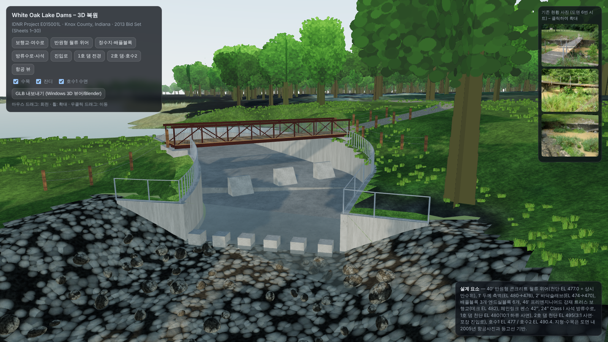
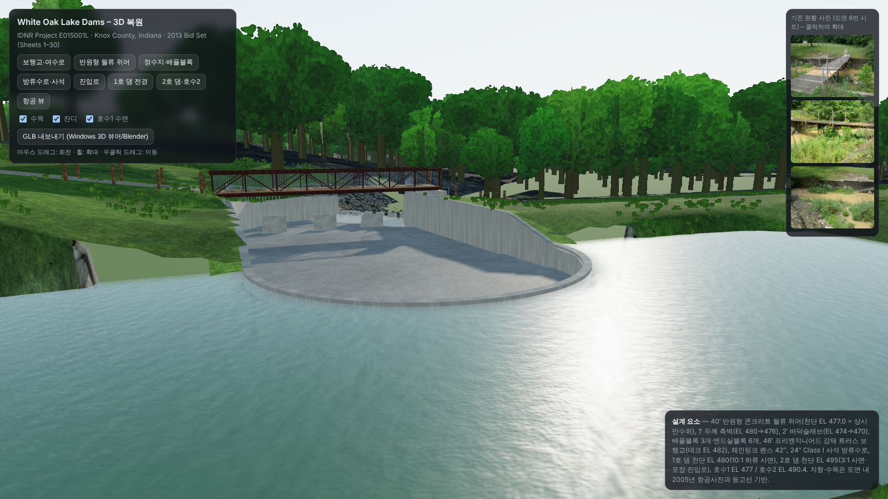
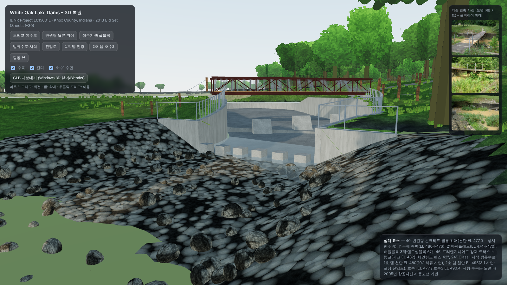
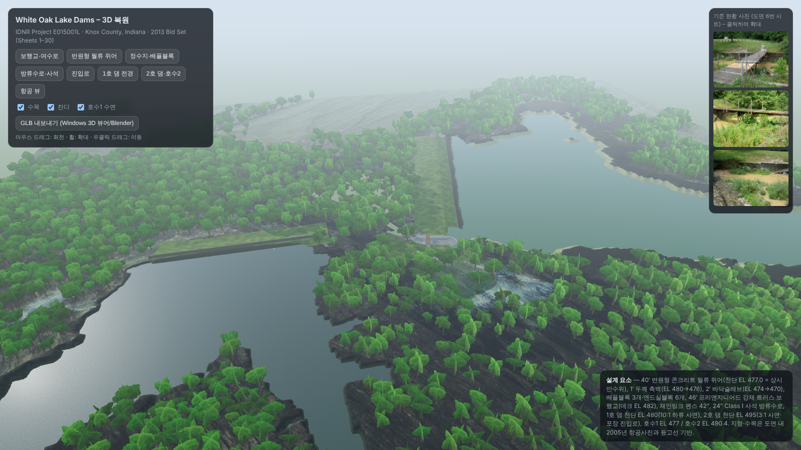

# White Oak Lake Dams – 3D Reconstruction

A photoreal-leaning 3D reconstruction of the **White Oak Lake Dams Rehabilitation of Dam 1 and 2 / Dam Upgrade Project**
(Indiana Department of Natural Resources, Project No. E015001L, White Oak State Fishing Area, Knox County, Indiana),
built entirely from the September 2013 bid-set drawings (30 sheets, Commonwealth Engineers / KIVA Structural Engineers).



| Semicircular weir | Riprap outlet channel | Aerial |
|---|---|---|
|  |  |  |

## What is in the repository

| Path | Contents |
|---|---|
| `viewer/` | Browser viewer (Three.js r170, ES modules from jsDelivr). Open `index.html` through any static web server. |
| `viewer/assets/` | Generated terrain heightmap (16-bit, encoded in PNG), aerial-derived albedo, water masks, tree/grass placements, procedural PBR textures and the three existing-condition photos from sheet 6. |
| `model/white_oak_lake_dams.glb` | The whole scene baked to glTF binary (41 MB). Opens directly in Windows **3D Viewer**, Blender, Unity, Unreal, etc. Units are feet, Y-up, elevations in NAVD88. |
| `tools/gen_terrain.py` | Builds the heightmap, masks, albedo and vegetation placements from the aerial embedded in sheet 3 plus the contour/profile data in the plans. |
| `tools/gen_textures.py` | Procedural, tileable textures (concrete, riprap, grass, gravel, wood, weathering steel, chain-link, leaf sprites, water normals). |
| `tools/build.py`, `tools/index_template.html` | Produce `index.html` variants (CDN / local / artifact) from one template. |
| `tools/shot.mjs` | Headless Playwright renderer used for the images in `renders/` and the GLB export. |
| `renders/` | Eight preset camera views at 1600×900. |
| `ref/` | The existing-condition photos and the 2005 aerial crop extracted from the PDF, used as references. |

## Live viewer

https://youngbrain85.github.io/white-oak-lake-dams-3d/viewer/ (GitHub Pages, served from the `main` branch root; `index.html` at the root redirects to the viewer)

## Running the viewer locally

The viewer fetches binary assets, so it has to be served over HTTP (double-clicking `index.html` will not load the terrain).

```bat
cd viewer
python -m http.server 8000
```

Then open http://localhost:8000. Controls: drag to orbit, wheel to zoom, right-drag to pan. The HUD has eight camera presets,
toggles for trees / grass / Lake 1 water, and a button that exports the scene as GLB.

To regenerate the assets from scratch:

```bat
pip install numpy pillow scipy
python tools\gen_terrain.py
python tools\gen_textures.py
python tools\build.py
```

`gen_terrain.py` expects the full-resolution aerial (`aerial-03.png`, sheet 3 rendered at 200 dpi, 1 px = 1 ft) in a sibling `ref/` folder;
extract it with `pdftoppm -r 200 -f 3 -l 3 -png BID_SET_White_Oak_Lake_Dams_2013.pdf aerial`.

## Design data reflected in the model

| Element | Value | Sheets |
|---|---|---|
| Overflow weir | Semicircular, 20.5 ft inside radius, crest EL 477.0 (normal pool), 1 ft thick | 7, 27, 29 |
| Spillway walls | 1 ft thick, top EL 480 → 477 → 476, bottom EL 466–467 | 27, 28, 29 |
| Floor slab | 24 / 18 / 12 in., EL 473.46 → 472.0 → 470.0, curved section R = 35.5 ft (left) / 31.5 ft (right) | 27, 28 |
| Baffle blocks | 3, 3 ft 9 in. high, upstream face 60 ft from the weir center | 27, 30 |
| End-sill blocks | 6, 2 × 2 ft × 1 ft 9 in. | 29 |
| Pedestrian bridge | 46 ft clear span, 8 ft wide, pre-engineered steel truss, deck EL 482.0 (bottom of steel ≥ 481.75) | 30 |
| Fencing | 42 in. chain-link on wall tops; 6×6 post-and-cable fence at the approaches | 15 |
| Outlet channel | 24 in. Class I riprap, invert EL 470 → 466, 23 ft → 40 ft wide, 2:1 side slopes | 10, 11 |
| Dam No. 1 | Crest EL 480, 10:1 downstream slope, 3:1 upstream, toe drain | 12–14, 16–18 |
| Dam No. 2 | Crest EL 495, 3:1 slopes, paved access drive on crest, 48 in. CMP riser (EL 490.31), toe drain outlets | 19–24 |
| Pool levels | Lake 1 EL 477.0 (lowered from 482.4), Lake 2 EL 490.4 | 7, 19 |

Coordinate frame: world X = east, Y = elevation (ft, NAVD88), Z = south. The spillway is modelled in a local frame whose origin is the
weir center (spillway station 30+45) with +x pointing downstream (WNW); `app.js` holds the rotation.

## Assumptions and limits

* Terrain is an interpolation of the 2005 aerial (1 in. = 200 ft) and the spot elevations / profiles in the drawings. It is not survey data.
* Trees and grass are placed by classifying woodland in the aerial; species, heights and positions are plausible, not surveyed.
* Buried work (cut-off wall, toe drains, waterstops, reinforcing) is not modelled.
* No public photographs of the completed project could be found online; the only references used are the photos and aerial contained in the bid set.

## Credits

Drawings: Indiana Department of Natural Resources; Commonwealth Engineers, Inc.; KIVA Structural Engineers (2013).
Model and tooling in this repository were generated from those drawings; the drawings themselves are not included.
